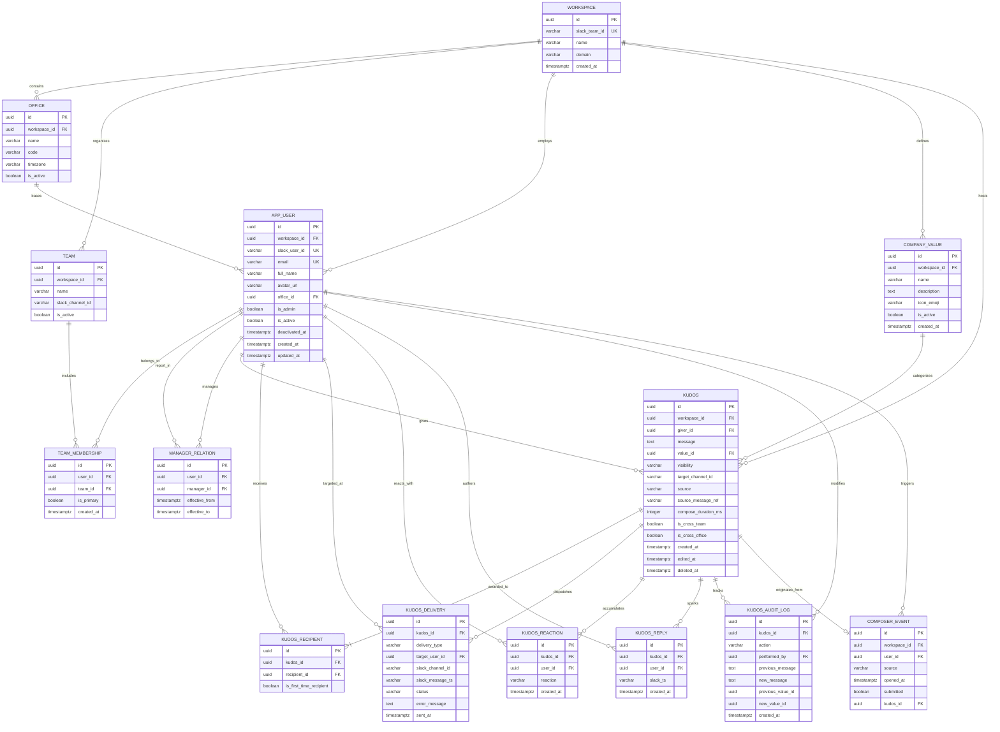

# Entity-Relationship Diagram (ERD) & Database Specification — Kudos V1 at CodeLink

**Authors:** Senior Backend Engineer & Senior Product Owner  
**Target Release:** Phase 1 (8-Week V1 Build)  
**Database Engine:** PostgreSQL 15+  
**Architecture:** Single-tenant, event-instrumented relational schema  

---

## 1. Entities and Attributes

### 1.1 `workspace`
Represents the single-tenant Slack workspace installation.
* `id` (`UUID`, PK, NOT NULL): Internal unique identifier.
* `slack_team_id` (`VARCHAR(32)`, UNIQUE, NOT NULL): Slack workspace team ID (e.g., `T01234567`).
* `name` (`VARCHAR(128)`, NOT NULL): Workspace display name (e.g., `CodeLink`).
* `domain` (`VARCHAR(128)`, NOT NULL): Slack workspace domain (e.g., `codelink`).
* `created_at` (`TIMESTAMPTZ`, NOT NULL, DEFAULT NOW()): Installation timestamp.

### 1.2 `office`
Represents physical CodeLink office locations.
* `id` (`UUID`, PK, NOT NULL): Internal unique identifier.
* `workspace_id` (`UUID`, FK -> `workspace.id`, NOT NULL): Workspace reference.
* `name` (`VARCHAR(64)`, NOT NULL): Name of office (e.g., `Ho Chi Minh City`, `Da Nang`, `Hanoi`).
* `code` (`VARCHAR(16)`, NOT NULL): Office abbreviation (e.g., `SGN`, `DAD`, `HAN`).
* `timezone` (`VARCHAR(64)`, NOT NULL): IANA timezone identifier (e.g., `Asia/Ho_Chi_Minh`).
* `is_active` (`BOOLEAN`, NOT NULL, DEFAULT TRUE): Active location flag.

### 1.3 `team`
Represents operational project groups, functional departments, or client pods.
* `id` (`UUID`, PK, NOT NULL): Internal unique identifier.
* `workspace_id` (`UUID`, FK -> `workspace.id`, NOT NULL): Workspace reference.
* `name` (`VARCHAR(64)`, NOT NULL): Team/pod name (e.g., `Fintech Core`, `Mobile Pod`, `Talent & Ops`).
* `slack_channel_id` (`VARCHAR(32)`, NULL): Associated default Slack channel ID (e.g., `C09876543`).
* `is_active` (`BOOLEAN`, NOT NULL, DEFAULT TRUE): Active team flag.

### 1.4 `app_user`
Represents all CodeLink employees, contractors, and administrative staff.
* `id` (`UUID`, PK, NOT NULL): Internal unique identifier.
* `workspace_id` (`UUID`, FK -> `workspace.id`, NOT NULL): Workspace reference.
* `slack_user_id` (`VARCHAR(32)`, UNIQUE, NOT NULL): Slack member ID (e.g., `U12345678`).
* `email` (`VARCHAR(255)`, UNIQUE, NOT NULL): Corporate email address.
* `full_name` (`VARCHAR(128)`, NOT NULL): Full display name.
* `avatar_url` (`VARCHAR(512)`, NULL): Profile photo URL.
* `office_id` (`UUID`, FK -> `office.id`, NOT NULL): Office location foreign key.
* `is_admin` (`BOOLEAN`, NOT NULL, DEFAULT FALSE): Talent/System administrator privilege flag.
* `is_active` (`BOOLEAN`, NOT NULL, DEFAULT TRUE): Active employment flag.
* `deactivated_at` (`TIMESTAMPTZ`, NULL): Timestamp of employee departure/deactivation.
* `created_at` (`TIMESTAMPTZ`, NOT NULL, DEFAULT NOW()): Record creation timestamp.
* `updated_at` (`TIMESTAMPTZ`, NOT NULL, DEFAULT NOW()): Record update timestamp.

### 1.5 `team_membership`
Represents the many-to-many relationship between users and teams.
* `id` (`UUID`, PK, NOT NULL): Internal unique identifier.
* `user_id` (`UUID`, FK -> `app_user.id`, NOT NULL): Employee reference.
* `team_id` (`UUID`, FK -> `team.id`, NOT NULL): Team reference.
* `is_primary` (`BOOLEAN`, NOT NULL, DEFAULT TRUE): Flag for the user's main project/department pod.
* `created_at` (`TIMESTAMPTZ`, NOT NULL, DEFAULT NOW()): Membership assignment timestamp.

### 1.6 `manager_relation`
Tracks historical and current direct reporting lines between staff.
* `id` (`UUID`, PK, NOT NULL): Internal unique identifier.
* `user_id` (`UUID`, FK -> `app_user.id`, NOT NULL): Direct report reference.
* `manager_id` (`UUID`, FK -> `app_user.id`, NOT NULL): Line manager reference.
* `effective_from` (`TIMESTAMPTZ`, NOT NULL, DEFAULT NOW()): Reporting relationship start date.
* `effective_to` (`TIMESTAMPTZ`, NULL): Reporting relationship end date (NULL = currently active).

### 1.7 `company_value`
Represents official CodeLink core cultural values available for tagging.
* `id` (`UUID`, PK, NOT NULL): Internal unique identifier.
* `workspace_id` (`UUID`, FK -> `workspace.id`, NOT NULL): Workspace reference.
* `name` (`VARCHAR(64)`, NOT NULL): Value name (e.g., `Extreme Ownership`, `Craftsmanship`, `Empathy`).
* `description` (`TEXT`, NOT NULL): Helper explanation displayed in modal tooltip.
* `icon_emoji` (`VARCHAR(32)`, NOT NULL): Associated Slack emoji code (e.g., `:hammer_and_wrench:`).
* `is_active` (`BOOLEAN`, NOT NULL, DEFAULT TRUE): Active selection status.
* `created_at` (`TIMESTAMPTZ`, NOT NULL, DEFAULT NOW()): Creation timestamp.

### 1.8 `kudos`
The central transaction record representing an issued praise.
* `id` (`UUID`, PK, NOT NULL): Internal unique identifier.
* `workspace_id` (`UUID`, FK -> `workspace.id`, NOT NULL): Workspace reference.
* `giver_id` (`UUID`, FK -> `app_user.id`, NOT NULL): Giver employee reference.
* `message` (`TEXT`, NOT NULL): The praise message content ($\ge 30$ characters).
* `value_id` (`UUID`, FK -> `company_value.id`, NULL): Optional tagged core value.
* `visibility` (`VARCHAR(20)`, NOT NULL): One of `'TEAM'`, `'COMPANY'`, or `'PRIVATE'`.
* `target_channel_id` (`VARCHAR(32)`, NULL): Slack channel ID where posted (NULL for private).
* `source` (`VARCHAR(20)`, NOT NULL): Origin: `'COMMAND'`, `'SHORTCUT'`, or `'APP_HOME'`.
* `source_message_ref` (`VARCHAR(512)`, NULL): Slack permalink URL if initiated via message shortcut.
* `compose_duration_ms` (`INTEGER`, NOT NULL): Total time in milliseconds from modal open to submission.
* `is_cross_team` (`BOOLEAN`, NOT NULL, DEFAULT FALSE): Computed flag indicating $\ge 1$ recipient is in a different primary team.
* `is_cross_office` (`BOOLEAN`, NOT NULL, DEFAULT FALSE): Computed flag indicating $\ge 1$ recipient is in a different office.
* `created_at` (`TIMESTAMPTZ`, NOT NULL, DEFAULT NOW()): Timestamp of creation.
* `edited_at` (`TIMESTAMPTZ`, NULL): Timestamp of latest edit.
* `deleted_at` (`TIMESTAMPTZ`, NULL): Soft-delete timestamp (non-null = deleted).

### 1.9 `kudos_recipient`
Associates one or more employees as recipients of a single kudos.
* `id` (`UUID`, PK, NOT NULL): Internal unique identifier.
* `kudos_id` (`UUID`, FK -> `kudos.id`, NOT NULL): Kudos record reference.
* `recipient_id` (`UUID`, FK -> `app_user.id`, NOT NULL): Recipient employee reference.
* `is_first_time_recipient` (`BOOLEAN`, NOT NULL, DEFAULT FALSE): Flag indicating recipient had 0 prior kudos at delivery.

### 1.10 `kudos_reaction`
Aggregates Slack emoji reactions added to public channel posts.
* `id` (`UUID`, PK, NOT NULL): Internal unique identifier.
* `kudos_id` (`UUID`, FK -> `kudos.id`, NOT NULL): Associated kudos reference.
* `user_id` (`UUID`, FK -> `app_user.id`, NOT NULL): Employee who reacted.
* `reaction` (`VARCHAR(64)`, NOT NULL): Slack emoji identifier (e.g., `+1`, `fire`, `heart`).
* `created_at` (`TIMESTAMPTZ`, NOT NULL, DEFAULT NOW()): Timestamp reaction was detected.

### 1.11 `kudos_reply`
Aggregates threaded comments posted under a public Slack kudos post.
* `id` (`UUID`, PK, NOT NULL): Internal unique identifier.
* `kudos_id` (`UUID`, FK -> `kudos.id`, NOT NULL): Associated kudos reference.
* `user_id` (`UUID`, FK -> `app_user.id`, NOT NULL): Author of the thread comment.
* `slack_ts` (`VARCHAR(32)`, NOT NULL): Slack message timestamp identifier.
* `created_at` (`TIMESTAMPTZ`, NOT NULL, DEFAULT NOW()): Timestamp comment was created.

### 1.12 `kudos_delivery`
Tracks asynchronous delivery status across Slack channels and individual direct messages.
* `id` (`UUID`, PK, NOT NULL): Internal unique identifier.
* `kudos_id` (`UUID`, FK -> `kudos.id`, NOT NULL): Associated kudos reference.
* `delivery_type` (`VARCHAR(20)`, NOT NULL): Delivery target: `'CHANNEL'`, `'RECIPIENT_DM'`, or `'MANAGER_DM'`.
* `target_user_id` (`UUID`, FK -> `app_user.id`, NULL): Target user reference for DMs.
* `slack_channel_id` (`VARCHAR(32)`, NOT NULL): Slack conversation ID where dispatched.
* `slack_message_ts` (`VARCHAR(32)`, NULL): Slack message timestamp string for subsequent edits/deletes.
* `status` (`VARCHAR(20)`, NOT NULL): Status: `'PENDING'`, `'SENT'`, `'FAILED'`, or `'SUPPRESSED'`.
* `error_message` (`TEXT`, NULL): Details if dispatch encounters a Slack API failure.
* `sent_at` (`TIMESTAMPTZ`, NULL): Actual dispatch confirmation timestamp.

### 1.13 `composer_event`
Telemetry recording modal openings to compute funnel conversion and composer friction.
* `id` (`UUID`, PK, NOT NULL): Internal unique identifier.
* `workspace_id` (`UUID`, FK -> `workspace.id`, NOT NULL): Workspace reference.
* `user_id` (`UUID`, FK -> `app_user.id`, NOT NULL): Employee who triggered composer.
* `source` (`VARCHAR(20)`, NOT NULL): Entry point: `'COMMAND'`, `'SHORTCUT'`, or `'APP_HOME'`.
* `opened_at` (`TIMESTAMPTZ`, NOT NULL, DEFAULT NOW()): Timestamp modal was rendered.
* `submitted` (`BOOLEAN`, NOT NULL, DEFAULT FALSE): Flag indicating whether this session resulted in `kudos_sent`.
* `kudos_id` (`UUID`, FK -> `kudos.id`, NULL): Associated kudos if successfully submitted.

### 1.14 `kudos_audit_log`
Immutable historical log of all modifications and soft deletions occurring within the 15-minute window.
* `id` (`UUID`, PK, NOT NULL): Internal unique identifier.
* `kudos_id` (`UUID`, FK -> `kudos.id`, NOT NULL): Target kudos reference.
* `action` (`VARCHAR(20)`, NOT NULL): Action executed: `'EDIT'` or `'DELETE'`.
* `performed_by` (`UUID`, FK -> `app_user.id`, NOT NULL): User who initiated action.
* `previous_message` (`TEXT`, NULL): Message content prior to modification.
* `new_message` (`TEXT`, NULL): Message content after modification (NULL if delete).
* `previous_value_id` (`UUID`, NULL): Previous company value reference.
* `new_value_id` (`UUID`, NULL): New company value reference.
* `created_at` (`TIMESTAMPTZ`, NOT NULL, DEFAULT NOW()): Action execution timestamp.

### 1.15 `system_setting`
Stores fixed baseline configuration values for V1 (e.g., character limits, edit windows).
* `key` (`VARCHAR(64)`, PK, NOT NULL): Configuration key string.
* `value` (`VARCHAR(255)`, NOT NULL): Configuration parameter string.
* `description` (`VARCHAR(255)`, NOT NULL): Description of rule.
* `updated_at` (`TIMESTAMPTZ`, NOT NULL, DEFAULT NOW()): Last modification timestamp.

---

## 2. Relationships and Cardinality

* **Workspace to Office:** One `workspace` has **1..n** `office` records.
* **Workspace to Team:** One `workspace` has **0..n** `team` records.
* **Workspace to AppUser:** One `workspace` has **1..n** `app_user` records.
* **Workspace to CompanyValue:** One `workspace` has **0..n** `company_value` records.
* **Office to AppUser:** One `office` houses **0..n** `app_user` records; each `app_user` belongs to exactly **1** `office`.
* **Team to TeamMembership:** One `team` contains **0..n** `team_membership` records; each `team_membership` links to exactly **1** `team`.
* **AppUser to TeamMembership:** One `app_user` has **1..n** `team_membership` records.
* **AppUser to ManagerRelation (as Report):** One `app_user` has **0..n** `manager_relation` records over time, with at most **1** active (`effective_to IS NULL`).
* **AppUser to ManagerRelation (as Manager):** One `app_user` acts as manager for **0..n** `manager_relation` records.
* **AppUser to Kudos (Giver):** One `app_user` gives **0..n** `kudos`.
* **Kudos to KudosRecipient:** One `kudos` has **1..n** `kudos_recipient` records.
* **AppUser to KudosRecipient:** One `app_user` receives **0..n** `kudos_recipient` records.
* **CompanyValue to Kudos:** One `company_value` is tagged in **0..n** `kudos`; each `kudos` tags **0..1** `company_value`.
* **Kudos to KudosDelivery:** One `kudos` generates **1..n** `kudos_delivery` records (channel post, recipient DMs, manager DMs).
* **Kudos to KudosReaction:** One `kudos` receives **0..n** `kudos_reaction` records.
* **Kudos to KudosReply:** One `kudos` receives **0..n** `kudos_reply` records.
* **Kudos to KudosAuditLog:** One `kudos` has **0..n** `kudos_audit_log` records.
* **AppUser to ComposerEvent:** One `app_user` generates **0..n** `composer_event` records.

---

## 3. Mermaid ERD Diagram



---

## 4. Indexes and Constraints

```sql
-- ============================================================================
-- 1. DATABASE-LEVEL INTEGRITY CONSTRAINTS
-- ============================================================================

-- Ensure message text meets the 30-character quality minimum
ALTER TABLE kudos 
  ADD CONSTRAINT chk_kudos_min_length 
  CHECK (char_length(trim(message)) >= 30);

-- Prevent duplicate recipient rows on the same kudos
ALTER TABLE kudos_recipient 
  ADD CONSTRAINT uq_kudos_recipient 
  UNIQUE (kudos_id, recipient_id);

-- Enforce visibility enum domain
ALTER TABLE kudos 
  ADD CONSTRAINT chk_kudos_visibility 
  CHECK (visibility IN ('TEAM', 'COMPANY', 'PRIVATE'));

-- Enforce delivery status enum domain
ALTER TABLE kudos_delivery 
  ADD CONSTRAINT chk_delivery_status 
  CHECK (status IN ('PENDING', 'SENT', 'FAILED', 'SUPPRESSED'));

-- Enforce delivery type enum domain
ALTER TABLE kudos_delivery 
  ADD CONSTRAINT chk_delivery_type 
  CHECK (delivery_type IN ('CHANNEL', 'RECIPIENT_DM', 'MANAGER_DM'));

-- Ensure only one active direct manager per employee
CREATE UNIQUE INDEX uq_active_manager_per_user 
  ON manager_relation (user_id) 
  WHERE effective_to IS NULL;

-- Ensure a user has at most one primary team
CREATE UNIQUE INDEX uq_single_primary_team 
  ON team_membership (user_id) 
  WHERE is_primary = TRUE;

-- ============================================================================
-- 2. SELF-KUDOS PREVENTION (TRIGGER-BASED ENFORCEMENT)
-- ============================================================================
CREATE OR REPLACE FUNCTION check_no_self_kudos()
RETURNS TRIGGER AS $$
BEGIN
  IF EXISTS (
    SELECT 1 FROM kudos k 
    WHERE k.id = NEW.kudos_id 
      AND k.giver_id = NEW.recipient_id
  ) THEN
    RAISE EXCEPTION 'Database Constraint Violation: Giver cannot be a recipient of their own kudos.';
  END IF;
  RETURN NEW;
END;
$$ LANGUAGE plpgsql;

CREATE TRIGGER trg_no_self_kudos
BEFORE INSERT OR UPDATE ON kudos_recipient
FOR EACH ROW EXECUTE FUNCTION check_no_self_kudos();

-- ============================================================================
-- 3. PERFORMANCE INDEXES (FOR FEED FILTERING & REPORTING)
-- ============================================================================

-- Fast lookup for Public Web Wall feed (excluding soft-deleted and private items)
CREATE INDEX idx_kudos_public_feed 
  ON kudos (created_at DESC) 
  WHERE deleted_at IS NULL AND visibility != 'PRIVATE';

-- Fast lookup for Giver history in App Home
CREATE INDEX idx_kudos_giver_history 
  ON kudos (giver_id, created_at DESC) 
  WHERE deleted_at IS NULL;

-- Fast recipient history lookup via join table
CREATE INDEX idx_kudos_recipient_lookup 
  ON kudos_recipient (recipient_id, kudos_id);

-- Support 30-Day Reach and Monthly Active Giver calculations
CREATE INDEX idx_kudos_active_date_range 
  ON kudos (created_at) 
  WHERE deleted_at IS NULL;

-- Slack Message TS lookup for 15-minute edits, deletes, and reaction webhooks
CREATE INDEX idx_delivery_slack_lookup 
  ON kudos_delivery (slack_channel_id, slack_message_ts);

-- Optimizes the "Not Recognised in 30 Days" query
CREATE INDEX idx_kudos_recipient_recent 
  ON kudos_recipient (recipient_id);
```

---

## 5. Metric Computation Queries (Pseudo-SQL)

### 5.1 North Star: Weekly Active Givers (4-Week Rolling Average)
*Target: 25% by Month 3; 40% by Month 6.*

```sql
WITH date_bounds AS (
  SELECT 
    NOW() - INTERVAL '28 days' AS start_date,
    NOW() AS end_date
),
weekly_buckets AS (
  SELECT 
    date_trunc('week', k.created_at) AS week_start,
    COUNT(DISTINCT k.giver_id) AS active_givers
  FROM kudos k
  JOIN app_user u ON k.giver_id = u.id
  WHERE k.deleted_at IS NULL
    AND k.created_at >= (SELECT start_date FROM date_bounds)
    AND u.is_active = TRUE
  GROUP BY 1
),
eligible_staff AS (
  SELECT COUNT(*) AS total_eligible
  FROM app_user
  WHERE is_active = TRUE
)
SELECT 
  wb.week_start,
  wb.active_givers,
  es.total_eligible,
  ROUND((wb.active_givers::numeric / es.total_eligible::numeric) * 100, 2) AS weekly_active_giver_pct,
  ROUND(AVG((wb.active_givers::numeric / es.total_eligible::numeric) * 100) OVER (
    ORDER BY wb.week_start ROWS BETWEEN 3 PRECEDING AND CURRENT ROW
  ), 2) AS rolling_4week_avg_pct
FROM weekly_buckets wb
CROSS JOIN eligible_staff es;
```

---

### 5.2 30-Day Reach
*% of staff who either gave or received $\ge 1$ kudos in the last 30 days. Target: 80–85%.*

```sql
WITH eligible_staff AS (
  SELECT id FROM app_user WHERE is_active = TRUE
),
givers_last_30d AS (
  SELECT DISTINCT giver_id AS user_id
  FROM kudos
  WHERE created_at >= NOW() - INTERVAL '30 days'
    AND deleted_at IS NULL
),
receivers_last_30d AS (
  SELECT DISTINCT kr.recipient_id AS user_id
  FROM kudos_recipient kr
  JOIN kudos k ON kr.kudos_id = k.id
  WHERE k.created_at >= NOW() - INTERVAL '30 days'
    AND k.deleted_at IS NULL
),
reached_staff AS (
  SELECT user_id FROM givers_last_30d
  UNION
  SELECT user_id FROM receivers_last_30d
)
SELECT 
  COUNT(rs.user_id) AS reached_staff_count,
  (SELECT COUNT(*) FROM eligible_staff) AS total_eligible_staff,
  ROUND((COUNT(rs.user_id)::numeric / (SELECT COUNT(*) FROM eligible_staff)::numeric) * 100, 2) AS reach_30d_pct
FROM eligible_staff es
LEFT JOIN reached_staff rs ON es.id = rs.user_id;
```

---

### 5.3 Recipient Coverage
*% of staff who received $\ge 1$ kudos in the last 30 days. Target: $\ge 80\%$.*

```sql
WITH eligible_staff AS (
  SELECT id FROM app_user WHERE is_active = TRUE
),
received_last_30d AS (
  SELECT DISTINCT kr.recipient_id AS user_id
  FROM kudos_recipient kr
  JOIN kudos k ON kr.kudos_id = k.id
  WHERE k.created_at >= NOW() - INTERVAL '30 days'
    AND k.deleted_at IS NULL
)
SELECT 
  COUNT(rl.user_id) AS covered_recipients_count,
  (SELECT COUNT(*) FROM eligible_staff) AS total_eligible_staff,
  ROUND((COUNT(rl.user_id)::numeric / (SELECT COUNT(*) FROM eligible_staff)::numeric) * 100, 2) AS recipient_coverage_30d_pct
FROM eligible_staff es
LEFT JOIN received_last_30d rl ON es.id = rl.user_id;
```

---

### 5.4 Manager Participation
*% of active managers who gave $\ge 1$ kudos this calendar month. Target: $\ge 80\%$.*

```sql
WITH active_managers AS (
  SELECT DISTINCT manager_id AS user_id
  FROM manager_relation
  WHERE effective_to IS NULL
),
giving_managers_this_month AS (
  SELECT DISTINCT k.giver_id AS user_id
  FROM kudos k
  JOIN active_managers am ON k.giver_id = am.user_id
  WHERE k.created_at >= date_trunc('month', NOW())
    AND k.deleted_at IS NULL
)
SELECT 
  COUNT(gm.user_id) AS participating_managers_count,
  (SELECT COUNT(*) FROM active_managers) AS total_active_managers,
  ROUND((COUNT(gm.user_id)::numeric / (SELECT COUNT(*) FROM active_managers)::numeric) * 100, 2) AS manager_participation_pct
FROM active_managers am
LEFT JOIN giving_managers_this_month gm ON am.user_id = gm.user_id;
```

---

### 5.5 Cross-Team Share
*Kudos where any recipient is in a different primary team or office $\div$ all kudos. Target: $\ge 30\%$.*

```sql
SELECT 
  COUNT(CASE WHEN is_cross_team = TRUE OR is_cross_office = TRUE THEN 1 END) AS cross_boundary_kudos,
  COUNT(*) AS total_kudos,
  ROUND(
    (COUNT(CASE WHEN is_cross_team = TRUE OR is_cross_office = TRUE THEN 1 END)::numeric / COUNT(*)::numeric) * 100, 
    2
  ) AS cross_team_share_pct
FROM kudos
WHERE created_at >= NOW() - INTERVAL '30 days'
  AND deleted_at IS NULL;
```

---

### 5.6 Median Time to Send
*Median elapsed seconds from modal open to submission. Target: $< 30\text{ seconds}$.*

```sql
SELECT 
  ROUND(PERCENTILE_CONT(0.50) WITHIN GROUP (ORDER BY compose_duration_ms)::numeric / 1000.0, 2) AS median_time_to_send_seconds
FROM kudos
WHERE created_at >= NOW() - INTERVAL '30 days'
  AND deleted_at IS NULL;
```

---

### 5.7 Completion Rate
*Kudos sent $\div$ composers opened. Target: $\ge 70\%$.*

```sql
SELECT 
  COUNT(kudos_id) AS total_sent,
  COUNT(*) AS total_opened,
  ROUND((COUNT(kudos_id)::numeric / COUNT(*)::numeric) * 100, 2) AS completion_rate_pct
FROM composer_event
WHERE opened_at >= NOW() - INTERVAL '30 days';
```

---

### 5.8 Value-Tag Share
*Kudos with a tagged value $\div$ all kudos. Target: To be calibrated post-trial.*

```sql
SELECT 
  COUNT(value_id) AS kudos_with_value_tag,
  COUNT(*) AS total_kudos,
  ROUND((COUNT(value_id)::numeric / COUNT(*)::numeric) * 100, 2) AS value_tag_share_pct
FROM kudos
WHERE created_at >= NOW() - INTERVAL '30 days'
  AND deleted_at IS NULL;
```

---

### 5.9 "Not Recognised in 30 Days" List (Talent Admin Query)

```sql
SELECT 
  u.id AS user_id,
  u.full_name,
  u.email,
  o.name AS office_name,
  t.name AS primary_team_name,
  m.full_name AS manager_name
FROM app_user u
JOIN office o ON u.office_id = o.id
LEFT JOIN team_membership tm ON u.id = tm.user_id AND tm.is_primary = TRUE
LEFT JOIN team t ON tm.team_id = t.id
LEFT JOIN manager_relation mr ON u.id = mr.user_id AND mr.effective_to IS NULL
LEFT JOIN app_user m ON mr.manager_id = m.id
WHERE u.is_active = TRUE
  AND u.id NOT IN (
    SELECT DISTINCT kr.recipient_id
    FROM kudos_recipient kr
    JOIN kudos k ON kr.kudos_id = k.id
    WHERE k.created_at >= NOW() - INTERVAL '30 days'
      AND k.deleted_at IS NULL
  )
ORDER BY o.name, t.name, u.full_name;
```

---

## 6. Privacy, Soft Deletion, and Retention

### 6.1 Soft-Delete Architecture
* When a user deletes a kudos within the 15-minute window, the backend executes an `UPDATE kudos SET deleted_at = NOW() WHERE id = :id`.
* The Slack channel post and bot DMs are updated in-place via `chat.update` to display: `~This kudos was deleted by the sender.~`.
* Any query serving App Home or the Web Wall contains an explicit filter `WHERE deleted_at IS NULL`.
* Deletion events write an immutable audit log to `kudos_audit_log` capturing `performed_by`, timestamp, and previous contents to safeguard against harassment or compliance disputes.

### 6.2 Departed Employees (`app_user` Deactivation)
* When an employee leaves CodeLink, their `is_active` attribute is set to `FALSE` and `deactivated_at = NOW()` via Slack directory synchronization.
* Past kudos records are preserved to honor historical context. The recipient joins continue to link back to the user ID.
* The application layer renders departed users as `"Name (Departed)"` with a placeholder avatar and disables linking to their person page.
* Deactivated employees are automatically excluded from the denominators of active metric calculations (`eligible_staff`), avoiding metric skew.

### 6.3 Talent CSV Export Scope
* The Talent Admin CSV export generates an audit trail of recognition for culture reporting.
* **Fields Included:** `kudos_id`, `created_at`, `giver_name`, `giver_office`, `giver_team`, `recipient_names`, `recipient_offices`, `recipient_teams`, `value_name`, `is_cross_team`, `is_cross_office`, `reaction_count`, `reply_count`.
* **Fields Scrubbed / Anonymized:** For `visibility = 'PRIVATE'` kudos, the `message` body is explicitly masked as `"[PRIVATE KUDOS]"` in the export to maintain confidentiality between giver, recipient, and manager.

---

## 7. Extension Notes (Future Proofing for V2 and V3)

The V1 schema is designed to attach V2 and V3 capabilities cleanly without requiring structural migrations of core tables:

### 7.1 V2: Allowances and Monthly Recap DMs
* **`allowance_period` Table:** Can be attached directly with attributes `(id, user_id, period_start, period_end, total_allowance, remaining_allowance)`.
* **Constraint:** A foreign key `kudos.allowance_period_id` can be added as nullable. V1 records simply remain `NULL`.

### 7.2 V2: Rotating Fair Awards
* **`award_cycle` Table:** Can be attached as `(id, title, category, start_date, end_date, judging_criteria)`.
* **`award_nomination` Table:** Can link directly to existing `kudos_id` rows: `(id, award_cycle_id, kudos_id, reason, selected_by)`. This leverages V1 praise as primary evidence without relying on volume count.

### 7.3 V3: Points, Ledgers, and Reward Catalogs
* **`point_ledger` Table:** Can attach using an event-sourcing ledger model:
  ```sql
  CREATE TABLE point_ledger (
    id UUID PRIMARY KEY,
    user_id UUID REFERENCES app_user(id),
    kudos_id UUID REFERENCES kudos(id), -- NULL for non-kudos adjustments
    event_type VARCHAR(32) NOT NULL,    -- 'KUDOS_GIVEN', 'KUDOS_RECEIVED', 'REDEEMED'
    points INTEGER NOT NULL,            -- e.g., +10, -500
    created_at TIMESTAMPTZ NOT NULL DEFAULT NOW()
  );
  ```
* **Separation of Concerns:** Core `kudos` table attributes remain unmodified. Points represent a derivative financial ledger linked to underlying `kudos_id` event IDs, protecting the core recognition graph from ledger migrations.

---

## Assumptions I Made
1. **Organizational Data Source:** Assumed CodeLink maintains up-to-date reporting hierarchies (`manager_id`) and office locations in Slack custom profile fields, with manual Talent CSV upload as an operational fallback.
2. **Channel Structure:** Assumed each team or project pod has at least one dedicated public or private Slack channel where the bot has been invited, used for default "Team channel" delivery.
3. **Values Tagging:** Assumed tagging a company core value is optional in V1 to maintain under-30-second completion velocity, but prominently encouraged via Block Kit UI.
4. **Single-Tenant Deployment:** Assumed CodeLink will host the backend service internally on their existing cloud infrastructure (AWS/GCP), precluding the need for multi-tenant billing or workspace isolation schemas in V1.
5. **Private Kudos Visibility:** Assumed private kudos should be delivered to the recipient *and* their direct manager via bot DM, honoring both employee confidentiality from the public wall and the directional survey mandate that managers notice their work. Talent Admins cannot view private message text.
